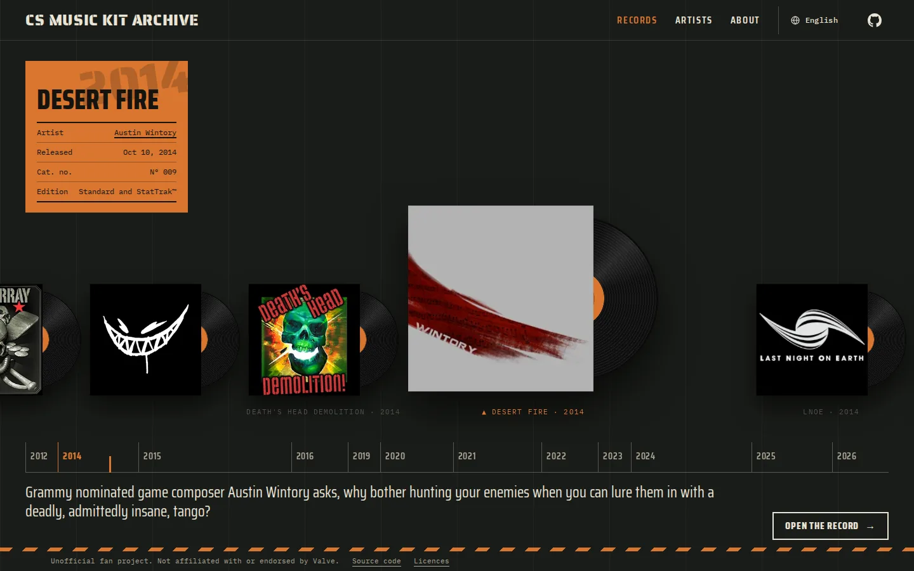

<h1 align="center">CS Music Kit Archive</h1>

<p align="center">
  Every Counter-Strike music kit, with its full tracklist, in all 28 languages of CS2.
  <br />
  <a href="https://musickitarchive.com">Website</a>
  ·
  <a href="https://musickitarchive.com/en/about/">About</a>
  ·
  <a href="https://github.com/shirodune/cs-music-kit-archive/issues">Report a mistake</a>
</p>

<p align="center">
  
</p>

## About

An unofficial, non-commercial fan site. In the game you only hear a short preview of a music kit; here every kit has its own page where each track plays in full.

- **Every kit**, from the default CS:GO music of 2012 to today, on a rack in order of release.
- **Straight from the game**: tracks and covers are taken from CS2's own files and published unchanged. Names and descriptions are Valve's own text in each language.
- **Sourced release dates**: each one links to the Valve release note that announced it.
- **Artists**: a page per artist with their kits and links from MusicBrainz.
- **28 languages**, the same ones CS2 has.

A weekly job checks the game for new and changed kits and opens a pull request.

## Development

Requires Node 26 (`.node-version`) and pnpm.

```sh
pnpm install
pnpm dev          # local dev server
pnpm verify       # lint, types, i18n check, unit tests, build, end-to-end tests
```

Astro (static output) with React islands, Tailwind CSS, TypeScript, Vitest and Playwright. Hosted on Cloudflare Workers, audio on Cloudflare R2.

- [`spec/`](spec/README.md) is the source of truth for what the site does and why. Read it before changing behaviour, and update it in the same change.
- [`docs/maintainers.md`](docs/maintainers.md) covers the data commands, extracting audio and covers from the game, and the weekly sync. Contributors do not need it.

## Contributing

Found a wrong date, name or link? [Open an issue](https://github.com/shirodune/cs-music-kit-archive/issues). Pull requests are welcome: run `pnpm verify` first. Release dates need a Valve source (spec DATA-13, DATA-14), and Valve's own text is never edited or machine translated.

## Licence

- Code: [MIT](LICENSE)
- Our curated data (`data/curated/`): [CC0 1.0](LICENSE-DATA), public domain
- Our writing (`content/`): [CC BY 4.0](LICENSE-CONTENT)
- Third-party material (Valve's names, artwork, audio and game data; ByMykel's data; MusicBrainz links; fonts): see [NOTICE](NOTICE)

Not affiliated with or endorsed by Valve. Counter-Strike and all music kit names, artwork and audio belong to Valve and the respective artists.

## Thanks

[SteamDB GameTracking](https://github.com/SteamTracking/GameTracking-CS2) for the game data, ByMykel's [file tracker](https://github.com/ByMykel/counter-strike-file-tracker) and [CSGO-API](https://github.com/ByMykel/CSGO-API) for the translations and item data, [MusicBrainz](https://musicbrainz.org) for the artist links, and [Source 2 Viewer](https://github.com/ValveResourceFormat/ValveResourceFormat) and [DepotDownloader](https://github.com/SteamRE/DepotDownloader) for reading the game files.
